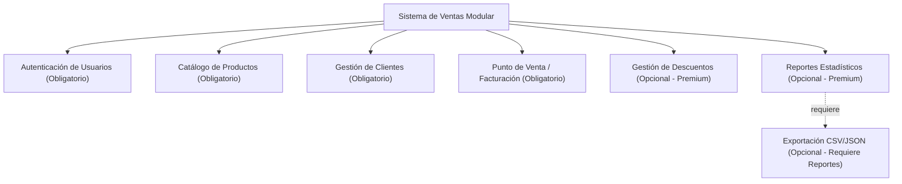
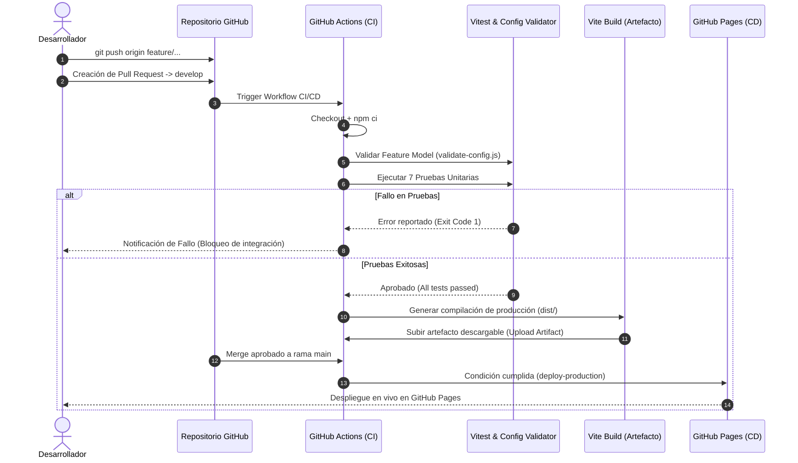

# INFORME TÉCNICO - COMPONENTE PRÁCTICO 2
## Implementación de un Flujo de Integración y Despliegue Continuo con Gestión de la Variabilidad del Software

---

**UNIVERSIDAD ESTATAL DE MILAGRO (UNEMI)**  
**FACULTAD DE CIENCIAS E INGENIERÍA**  
**CARRERA DE INGENIERÍA DE SOFTWARE**  

* **Asignatura:** Gestión de la Configuración de Software  
* **Nivel:** Octavo Nivel  
* **Modalidad:** Grupal  
* **Período Académico:** 2026 - 2027  
* **Docente:** Ing. Docente Asignado  
* **Integrantes del Grupo:**
  1. Estudiante 1 (Líder / Integración Continua)
  2. Estudiante 2 (Control de Versiones y Modelado)
  3. Estudiante 3 (Lógica de Negocio y Pruebas Unitarias)
  4. Estudiante 4 (Variabilidad y Feature Flags)
  5. Estudiante 5 (Despliegue Continuo y Documentación)

* **Enlaces de Entrega:**
  * **Repositorio de GitHub:** `[INSERTAR_ENLACE_AQUÍ]`
  * **Video Explicativo:** `[INSERTAR_ENLACE_AQUÍ]`
  * **Aplicación Desplegada (Producción):** `[INSERTAR_ENLACE_AQUÍ]`

---

## 1. Introducción

En el contexto actual de la ingeniería de software profesional, la capacidad de entregar valor continuo con alta calidad y adaptabilidad a las demandas del mercado es un factor diferenciador crítico. Las organizaciones frecuentemente enfrentan el desafío de comercializar diversas versiones de un mismo producto de software para segmentos de clientes con distintas necesidades y capacidades presupuestarias. Históricamente, muchas empresas recurrían a la duplicación física de repositorios o bases de código ("copy-paste"), lo cual deriva invariablemente en pesadillas de mantenimiento, divergencia de funcionalidades y deuda técnica insostenible.

El presente informe documenta el desarrollo y resultados del Componente Práctico 2 de la asignatura *Gestión de la Configuración de Software*. A lo largo de este proyecto, se implementó una **Línea de Productos de Software (Software Product Line - SPL)** soportada por una arquitectura moderna de **Integración Continua y Despliegue Continuo (CI/CD)**. A través de una única base de código compartida, se gestiona la variabilidad funcional mediante *Feature Flags* desacopladas y validadas automáticamente, garantizando que los cambios integrados pasen por una rigurosa suite de pruebas unitarias antes de ser construidos, empaquetados y desplegados de manera automática hacia un entorno en la nube.

---

## 2. Objetivo

Implementar un flujo de integración y despliegue continuo mediante herramientas de gestión de la configuración del software, incorporando mecanismos de automatización, control de versiones bajo metodología Gitflow, pruebas automatizadas, reutilización de código y gestión formal de la variabilidad, en un entorno de trabajo colaborativo.

---

## 3. Descripción del Sistema

El producto de software seleccionado para esta práctica es un **Sistema Modular de Gestión de Ventas y Facturación Comercial (SaaS)** orientado al comercio minorista y mayorista. La aplicación permite gestionar operaciones comerciales habituales y cuenta con una arquitectura diseñada para instanciar dos variantes comerciales:

1. **Variante Básica:** Dirigida a microempresas y pequeños negocios que requieren exclusivamente las operaciones esenciales: autenticación de usuarios, catálogo con tope de hasta 50 productos, administración de cartera de clientes y emisión de facturas estándar con cálculo automático de impuestos (IVA 15%).
2. **Variante Premium:** Dirigida a comercios medianos y grandes que demandan capacidades extendidas: capacidad de catálogo ampliada (hasta 5000 productos), módulo de gestión de cupones y descuentos promocionales aplicados a ventas, módulo analítico con métricas de ingresos, ticket promedio y volumen por cliente, y capacidad de exportar reportes en formatos CSV y JSON.

Ambas variantes se ejecutan a partir del **mismo código fuente base**, activando o restringiendo módulos mediante configuración formal.

---

## 4. Herramientas Tecnológicas y Justificación

| Herramienta | Finalidad en el Proyecto | Justificación Técnica |
| :--- | :--- | :--- |
| **Git & GitHub** | Control de versiones y repositorio colaborativo | Permite trazabilidad completa, aislamiento de funcionalidades mediante ramas, auditoría de cambios y gestión de Pull Requests entre múltiples desarrolladores. |
| **GitHub Actions** | Automatización de flujos de trabajo (CI/CD) | Motor de orquestación nativo, altamente escalable, que permite ejecutar contenedores de construcción, validar pruebas unitarias y coordinar despliegues sin infraestructura propia. |
| **Node.js & React (Vite)** | Entorno de ejecución y frontend del sistema | Vite provee tiempos de compilación y empaquetado ultra veloces mediante ES Modules, facilitando la modularización limpia de componentes condicionados por variabilidad. |
| **Vitest** | Framework de pruebas automatizadas | Compatible con la suite de Vite, ejecuta pruebas unitarias e integración en milisegundos con soporte nativo de aserciones y reportes detallados de cobertura. |
| **GitHub Pages** | Alojamiento y despliegue continuo (CD) | Plataforma de alojamiento estático conectada de forma directa con GitHub Actions, permitiendo despliegues automáticos seguros condicionados al paso de tests. |
| **Mermaid / Draw.io** | Modelado formal de características y flujos | Estándar visual para representar árboles de dependencias de variabilidad (*Feature Models*) y arquitectura de integración continua. |

---

## 5. Distribución de Responsabilidades del Equipo

| Integrante | Rol Asignado | Responsabilidades Específicas |
| :--- | :--- | :--- |
| **Estudiante 1** | Líder Técnico y Arquitecto CI/CD | Diseño general del flujo CI/CD en GitHub Actions, coordinación de integración en ramas `main` y `develop`, y orquestación del artefacto de entrega. |
| **Estudiante 2** | Ingeniero de Control de Versiones | Configuración de la estrategia Gitflow, políticas de Pull Requests, resolución de conflictos y gestión de los releases semánticos `v1.0.0` y `v1.1.0`. |
| **Estudiante 3** | Desarrollador de Lógica Comercial | Implementación del módulo de cálculo comercial (`salesCalculator.js`), gestión de impuestos e implementación de las pruebas unitarias automatizadas. |
| **Estudiante 4** | Ingeniero de Variabilidad de Software | Diseño del Modelo de Características, configuración de Feature Flags (`variants.json`) y desarrollo del script de validación automatizada (`validate-config.js`). |
| **Estudiante 5** | Especialista en Calidad y Despliegue | Configuración del pipeline de CD, simulación del fallo intencional de pruebas, verificación de artefactos en producción y elaboración de evidencias. |

---

## 6. Desarrollo de las Fases del Proyecto

### Fase 1. Selección del Producto de Software
Se seleccionó y diseñó el **Sistema de Gestión de Ventas**, estructurado en capas para garantizar la separación de conceptos:
* Capa de Presentación (Componentes React interactivos).
* Capa de Lógica de Negocio (Módulos puros de cálculo y exportación).
* Capa de Configuración de Variabilidad (Esquema JSON y módulo de inyección de características).

### Fase 2. Gestión del Repositorio y Control de Versiones
Para evitar la integración desordenada de código se adoptó el modelo **Gitflow**:
* **Rama `main`:** Aloja exclusivamente versiones estables y aprobadas que corresponden a entregas en producción.
* **Rama `develop`:** Rama de integración continua donde convergen las funcionalidades aprobadas tras superar las pruebas automatizadas.
* **Ramas de funcionalidad (`feature/...`):** Creadas de forma aislada para cada requerimiento:
  * `feature/auth-and-products`
  * `feature/sales-module`
  * `feature/discounts-variability`
  * `feature/premium-reports`
  * `feature/ci-cd-pipeline`

**Versionado Semántico (SemVer):**
Se crearon formalmente dos releases etiquetados en Git:
1. `v1.0.0`: Primer release estable que contiene el núcleo operativo del sistema comercial y la variante Básica.
2. `v1.1.0`: Segundo release que incorpora los módulos opcionales de la variante Premium (descuentos, analítica y exportación).

> *[PEGAR AQUÍ CAPTURA 1: Vista de ramas en GitHub o comando `git log --graph --oneline`]*  
> *[PEGAR AQUÍ CAPTURA 2: Vista de Releases en GitHub mostrando los tags `v1.0.0` y `v1.1.0`]*

---

### Fase 3. Implementación de la Integración Continua (CI)
El flujo de integración continua está definido en `.github/workflows/ci-cd.yml` en el job `build-and-test`. Sus pasos automatizados son:
1. **Descarga del código:** Uso de `actions/checkout@v4`.
2. **Entorno:** Configuración de Node.js v20 con caché de dependencias.
3. **Instalación:** `npm ci` para garantizar instalación determinista de paquetes.
4. **Validación del Feature Model:** Ejecución del script `node scripts/validate-config.js`.
5. **Ejecución de Pruebas Automatizadas:** Ejecución de 7 pruebas unitarias con Vitest.
6. **Empaquetado (Build):** Compilación minificada mediante `npm run build`.
7. **Generación de Artefacto:** Carga y almacenamiento del paquete `sales-system-production-build` mediante `actions/upload-artifact@v4`.

#### Evidencia de Fallo Intencional y Corrección
Para evidenciar el funcionamiento estricto del pipeline ante regresiones:
1. **Fallo Provocado:** Se alteró la aserción de la prueba de cálculo de subtotal en `tests/salesSystem.test.js`, esperando un valor deliberadamente erróneo (`9999.99` en lugar de `1020.00`).
2. **Resultado en CI:** El pipeline detuvo su ejecución de inmediato, reportando estado `FAILED` (código de salida 1) y cancelando la generación de artefactos y el posterior despliegue.
3. **Corrección:** Se restauró la aserción correcta, se registró el commit de corrección `fix: resolve test assertion discrepancy` y se ejecutó nuevamente el flujo, logrando estado `SUCCESS` (verde).

> *[PEGAR AQUÍ CAPTURA 3: Ejecución fallida en GitHub Actions con el detalle del log `AssertionError`]*  
> *[PEGAR AQUÍ CAPTURA 4: Ejecución exitosa de GitHub Actions tras la corrección]*  
> *[PEGAR AQUÍ CAPTURA 5: Sección de artefactos descargables (`sales-system-production-build`)]*

---

### Fase 4. Implementación del Despliegue Continuo (CD)
El despliegue continuo se implementó en el job `deploy-production`.

#### Condicionalidad Estricta:
El despliegue se encuentra estrictamente condicionado mediante la cláusula:
```yaml
needs: build-and-test
if: github.ref == 'refs/heads/main' && github.event_name == 'push'
```
Esto garantiza que:
1. Si cualquier prueba unitaria o la validación del modelo de características falla, el job de despliegue **nunca se ejecuta**.
2. Solo se publican despliegues que provengan de fusiones aprobadas hacia la rama productiva `main`.

El despliegue publica la aplicación estática en GitHub Pages, haciéndola accesible inmediatamente a través de la web para los usuarios finales.

> *[PEGAR AQUÍ CAPTURA 6: Diagrama del pipeline de GitHub Actions mostrando el job `deploy-production` enlazado a `build-and-test`]*  
> *[PEGAR AQUÍ CAPTURA 7: Aplicación en vivo funcionando en el enlace de producción]*

---

### Fase 5. Gestión de la Variabilidad y Reutilización de Código

#### 1. Modelo de Características (Feature Model)
La variabilidad del producto se diseñó mediante la técnica FODA (Feature-Oriented Domain Analysis):



#### 2. Matriz de Variabilidad
* **Características Obligatorias (*Mandatory*):** `auth`, `products`, `customers`, `sales`.
* **Características Opcionales (*Optional*):** `discounts`, `reports`, `export_reports`.
* **Dependencia cruzada (*Requires*):** La característica `export_reports` requiere obligatoriamente que `reports` esté activo.

#### 3. Mecanismo de Activación (Feature Flags)
La configuración de cada variante se centraliza en `config/variants.json`:
* **Variante Básica:**
  `{ "auth": true, "products": true, "customers": true, "sales": true, "discounts": false, "reports": false, "export_reports": false }`
* **Variante Premium:**
  `{ "auth": true, "products": true, "customers": true, "sales": true, "discounts": true, "reports": true, "export_reports": true }`

En tiempo de ejecución, el componente `features.js` evalúa las banderas para ocultar o activar los componentes de la interfaz de usuario y las reglas de negocio en los cálculos.

#### 4. Demostración de Cero Duplicación de Código
A diferencia de los enfoques obsoletos de mantener dos carpetas o dos proyectos separados (`/sistema-basico` y `/sistema-premium`), en este proyecto existe **un único conjunto de componentes**:
* `Sales.jsx` se reutiliza para ambas variantes; si la flag `discounts` está apagada, no calcula descuentos ni muestra selectores de promociones.
* `Navbar.jsx` renderiza dinámicamente solo las pestañas autorizadas por la configuración activa.
* El script `validate-config.js` verifica sintáctica y lógicamente que ninguna variante viole las restricciones del Feature Model antes de compilar.

> *[PEGAR AQUÍ CAPTURA 8: Interfaz de la Variante Básica (sin descuentos ni reportes)]*  
> *[PEGAR AQUÍ CAPTURA 9: Interfaz de la Variante Premium (con descuentos, reportes y botones de exportación)]*  
> *[PEGAR AQUÍ CAPTURA 10: Ejecución en consola de `npm run validate:config` exitosa]*

---

## 7. Diagrama de la Arquitectura CI/CD



---

## 8. Conclusiones

1. **Eficiencia en la Reutilización:** La implementación de una Línea de Productos de Software mediante *Feature Flags* demostró que es viable comercializar múltiples variantes de software a partir de una única base de código, eliminando completamente la duplicación y reduciendo los costos de mantenimiento a largo plazo.
2. **Mitigación de Errores con CI:** El flujo de integración continua con GitHub Actions y Vitest demostró ser una barrera de contención efectiva contra regresiones en código. La simulación del fallo intencional evidenció que ningún cambio con errores de lógica comercial puede avanzar a la etapa de empaquetado o despliegue.
3. **Despliegue Confiable y Seguro:** El condicionamiento estricto del despliegue continuo (`CD`) supeditado al 100% de éxito en las pruebas automatizadas garantiza que el entorno accesible por el cliente final siempre se mantenga en un estado estable y operativo.
4. **Disciplina Colaborativa:** El empleo de Gitflow, control semántico de versiones (`v1.0.0`, `v1.1.0`) y Pull Requests colegiados permitió al equipo simular con fidelidad un entorno de desarrollo corporativo de alta madurez.

---

## 9. Referencias Bibliográficas (Normas APA 7.ª Edición)

* Apel, S., Batory, D., Kästner, C., & Saake, G. (2016). *Feature-Oriented Software Product Lines: Concepts and Implementation*. Springer Science & Business Media.
* Chacon, S., & Straub, B. (2014). *Pro Git* (2nd ed.). Apress. https://git-scm.com/book/en/v2
* Fowler, M. (2018). *Continuous Integration*. MartinFowler.com. https://martinfowler.com/articles/continuousIntegration.html
* GitHub. (2024). *GitHub Actions Documentation*. GitHub Docs. https://docs.github.com/en/actions
* Humble, J., & Farley, D. (2010). *Continuous Delivery: Reliable Software Releases through Build, Test, and Deployment Automation*. Addison-Wesley Professional.
* Pohl, K., Böckle, G., & van der Linden, F. J. (2005). *Software Product Line Engineering: Foundations, Principles and Techniques*. Springer Science & Business Media.
* Vitest Team. (2024). *Vitest: Next Generation Testing Framework*. https://vitest.dev/
